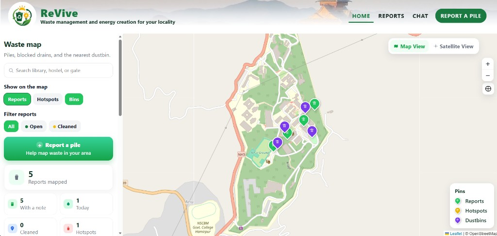
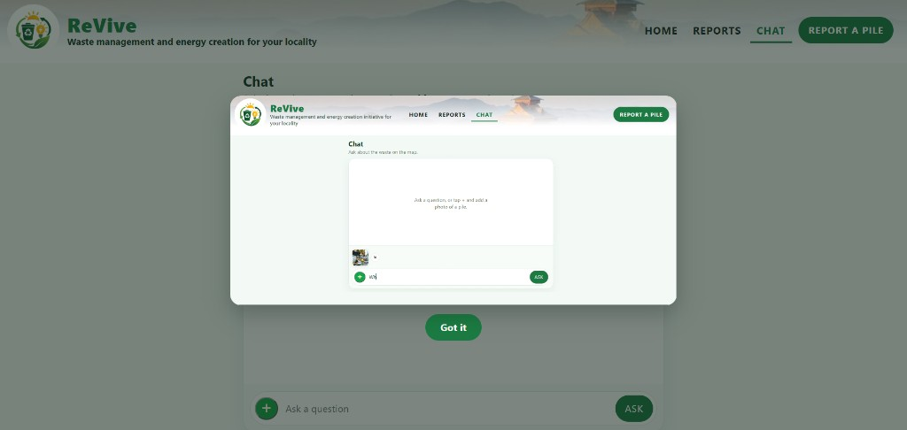
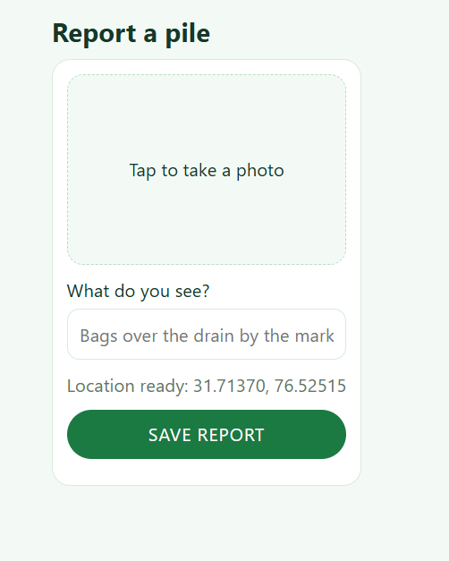

# ReVive

Waste management and energy creation for your locality.

ReVive is a campus waste map with photo reports, dustbin pins, and a Gemini chat that can estimate biogas from a pile photo. Say **guide my way** in chat to draw a red route across reported piles, or **from A to B** to draw a direct line between two places.

Built for the WeMakeDevs / AWS Environmental Hacks Waste and Energy track.

## Screenshots







## Features

- Map of reported piles, hotspots, and dustbins
- Search for campus places such as library, hostel, or gate
- Report a pile with a photo, note, and GPS location
- Chat with Gemini about the waste on the map
- Attach a pile photo in chat for a rough biogas estimate
- Demo video popup when Chat opens; **Got it** closes it
- **guide my way** draws a red path across piles
- **from A to B** draws a direct red line between two places

## Run locally

```bash
python -m pip install -r requirements.txt
python server.py
```

Open [http://127.0.0.1:8787](http://127.0.0.1:8787).

## Environment

Create a `.env` file in the project root (do not commit it):

```env
GEMINI_API_KEY=your_key_here
```

Get a key from [Google AI Studio](https://aistudio.google.com/apikey).

Optional AWS credentials are used only if Gemini is not set. Photos stay on the local machine when S3 is unavailable.

## Project layout

| Path | Purpose |
| --- | --- |
| `server.py` | HTTP server, reports API, chat API |
| `agent_chat.py` | Gemini chat and photo analysis |
| `web/` | Map, chat, styles, and demo video |
| `data/reports.json` | Saved pile reports |
| `data/uploads/` | Report photos |
| `screenshots/` | Product screenshots |
| `Procfile` | Process file for Elastic Beanstalk |

## Deploy

The app listens on `127.0.0.1:8787` locally. On Elastic Beanstalk it binds to `0.0.0.0` and uses `PORT` or `8000`.

```text
web: python3 server.py
```

## License

Hackathon submission for Environmental Hacks. Use and adapt for the competition demo.
